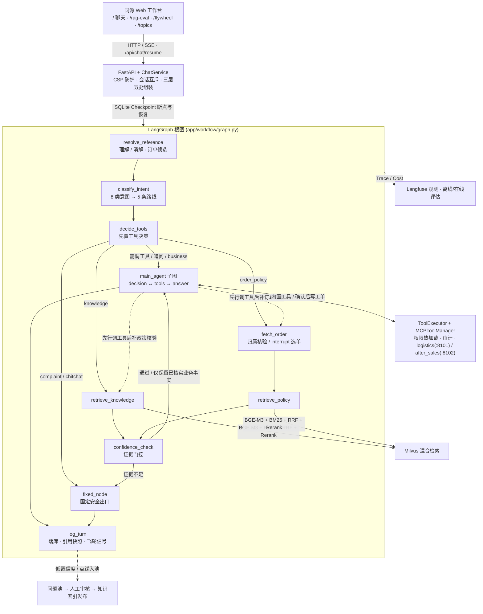

# 🐱 MewHelp

[](https://www.python.org/)
[](https://fastapi.tiangolo.com/)
[](https://www.langchain.com/langgraph)
[](https://milvus.io/)
[](https://modelcontextprotocol.io/)

**MewHelp** 是一个基于 **Python / FastAPI / LangGraph** 构建的电商智能客服后端与全栈工作台，涵盖多阶段 Agent 编排、混合知识检索与证据门控、动态 MCP 工具接入、三层上下文预算压缩、人机确认工单流，以及离线评估与可观测闭环。

---

## ✨ 核心能力

- **LangGraph 状态机与断点恢复**：支持查询改写、意图分流、有界多工具调用循环，通过 SQLite Checkpoint 持久化对话状态，支持中断与恢复。
- **混合检索与证据门控（Hybrid RAG）**：基于 `BGE-M3` 稠密向量与 `BM25` 稀疏检索（Milvus + RRF 融合）及本地重排；结合归一化阈值拒答机制、`[n]` 证据溯源快照及低置信度问题池（Flywheel）。
- **动态工具与 MCP 集成**：统一工具注册、权限热加载（`data/tools/mcp-permissions.json`）、单轮调用配额与超时控制、MySQL 工具审计；支持对接独立物流与售后 MCP 服务。
- **上下文预算与多轮压缩**：内置双层 Token 预算台账，按完整交互轮次裁剪历史并后台生成分段摘要，严格成对保留模型工具调用与执行结果。
- **人机协同（Human-in-the-Loop）工单流**：对话查询保持只读安全边界；涉及创建工单或售后申请时先输出预览，经用户独立确认后执行写入，并按动作 ID 保证幂等。
- **全链路可观测与评估面板**：同源内置聊天页（`/`）、RAG 评估看板（`/rag-eval`）、人工审核与飞轮后台（`/flywheel`）、主题聚类页（`/topics`），支持 Langfuse 链路追踪与成本统计。

---

## 🏗️ 系统架构



> 更细粒度的交互式节点说明（含全景、聊天主链路、三层上下文、知识检索、写入确认与飞轮闭环）见仓库内 [`docs/mewhelp-workflow.html`](docs/mewhelp-workflow.html)。

---
## 📂 项目结构

```text
MEWHELP/
├── app/
│   ├── api/             # FastAPI 路由（chat SSE、actions、citations、kb、flywheel、rageval、topics）
│   ├── core/            # LLM 适配、Token 预算台账、三层历史裁剪与提示词管理
│   ├── workflow/        # LangGraph 状态机、意图路由、证据闸门、上下文压缩与恢复
│   ├── knowledge/       # 文档切分、BGE-M3 向量化、Milvus 混合检索、重排与飞轮生命周期
│   ├── tools/           # 工具注册表、MCP 适配器、权限热加载、校验与审计执行器
│   ├── evaluation/      # 离线基准评测、忠实度校验、校准与定时评估调度
│   ├── observability/   # Langfuse 运行时接入与调用成本统计
│   ├── topics/          # 客服问题主题分类、标注与模型训练推理
│   ├── services/        # 会话编排、异步摘要、审核发布与动作幂等服务
│   ├── models/ & db/    # SQLAlchemy 异步模型、MySQL 初始化与增量迁移脚本
│   └── static/          # 零外部 CDN 的同源前端页面与静态资源（CSP 防护）
├── mcp_servers/         # 独立运行的物流（logistics）与售后（after_sales）MCP 服务
├── data/                # 知识库文档清单、检索/证据策略配置、评测集与 MCP 权限配置
├── docs/                # 各阶段运行手册、评测说明与验收报告
├── sql/                 # 手动建表与迁移 SQL 参考
└── tests/               # 单元测试、前端 node:test、MySQL 与 Milvus 集成测试
```

---

## 🚀 快速开始

### 1. 环境准备

- Python **3.12+** 与 [`uv`](https://docs.astral.sh/uv/)
- Docker & Docker Compose（用于启动 MySQL 与 Milvus）

安装依赖并启动基础设施：

```bash
uv sync
docker compose -f compose.yaml -f compose.milvus.yaml up -d --wait
```

复制 `.env.example` 为 `.env`（如需链路追踪可另配 `.env.langfuse`），填入模型接口与本地数据库配置。

### 2. 初始化数据库与知识库

首次初始化基础表结构，并按需执行增量迁移（详细升级与预览步骤见 [docs/](docs/) 与 [sql/README.md](sql/README.md)）：

```bash
uv run python -m app.db.init_db
uv run python -m app.db.migrate_rag_quality
uv run python -m app.db.migrate_citations --database mewhelp
```

> 若从历史版本升级表结构，请按顺序执行 `migrate_ch06` → `migrate_ch07` → `migrate_ch08` → `migrate_ch09`（启用主题分类时另执行 `migrate_ch10`），先不带 `--apply` 预览再确认写入。

初始化并同步知识库索引：

```bash
uv run python -m app.knowledge.cli init
uv run python -m app.knowledge.cli prepare-hybrid
uv run python -m app.knowledge.cli import-docs --mode hybrid --manifest data/kb/manifest.json
uv run python -m app.knowledge.cli sync --mode hybrid
```

### 3. 启动服务

启动主服务（单实例单 worker，保障 SQLite Checkpoint 与同会话互斥状态一致）：

```bash
uv run uvicorn app.main:app --host 127.0.0.1 --port 8000 --workers 1
```

在独立终端启动物流与售后 MCP 子服务：

```bash
uv run python -m mcp_servers.logistics --port 8101
uv run python -m mcp_servers.after_sales --port 8102
```

启动后可访问：
- 客服工作台：`http://127.0.0.1:8000/`
- 评测看板：`http://127.0.0.1:8000/rag-eval`
- 审核与知识飞轮：`http://127.0.0.1:8000/flywheel`
- 主题分析：`http://127.0.0.1:8000/topics`
- OpenAPI 文档：`http://127.0.0.1:8000/docs`

---

## 🧪 测试与 RAG 评估

### 运行测试

```bash
# 1. 离线单元测试与前端测试（无需外部模型与 MySQL）
CHAT_BASE_URL=http://test.invalid/v1 CHAT_MODEL=test-model CHAT_API_KEY=test-key uv run --offline --locked pytest -q
node --test tests/frontend/*.test.mjs

# 2. MySQL 集成测试（使用独立测试库 mewhelp_test）
uv run python -m app.db.init_db --test
uv run pytest -m mysql tests/integration -q

# 3. 知识库与 Milvus 集成测试（需先启动 Docker 中的 MySQL 与 Milvus）
uv run pytest tests/knowledge_integration --run-knowledge-integration -q
```

### 固定集检索基线（48 题评测）

在独立 48 题固定评测集（含 40 道可答题 + 8 道无答案拒答题）上的四种检索策略对比结果（详见 [评估题集说明](docs/ch04-evaluation-set.md) 与 [收尾验收报告](docs/ch04-closeout.md)）：

| 策略 | Recall@10 | MRR@10 | 覆盖率 | 误拒率 | 无答案正确拒答 | 忠实度宏平均（有效样本） |
|---|---:|---:|---:|---:|---:|---:|
| `dense` | 1.0000 | 0.8542 | 0.5833 | 0.3000 | 1.0000 | 1.0000 (28) |
| `bm25` | 1.0000 | 0.9833 | 0.6458 | 0.1750 | 1.0000 | 0.9667 (30) |
| `hybrid` | 1.0000 | 0.9375 | 0.7083 | 0.1000 | 1.0000 | 1.0000 (34) |
| `hybrid_rerank` | 1.0000 | 1.0000 | 0.5417 | 0.3000 | 1.0000 | 1.0000 (25) |

---

## 📖 扩展文档与运行说明

- **运行手册**：[知识检索运行手册](docs/ch04-runbook.md) · [工作流与动态工具手册](docs/ch08-runbook.md) · [观测与飞轮操作手册](docs/ch09-operations.md) · [主题分类操作手册](docs/ch10-operations.md)
- **运行边界**：项目定位为本地可复现演示与工程验证系统，默认仅监听 `127.0.0.1`（不含多租户鉴权与真实支付/物流写入），订单与物流工具基于确定性输入生成演示数据。